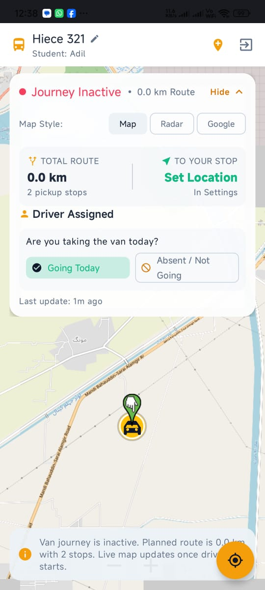
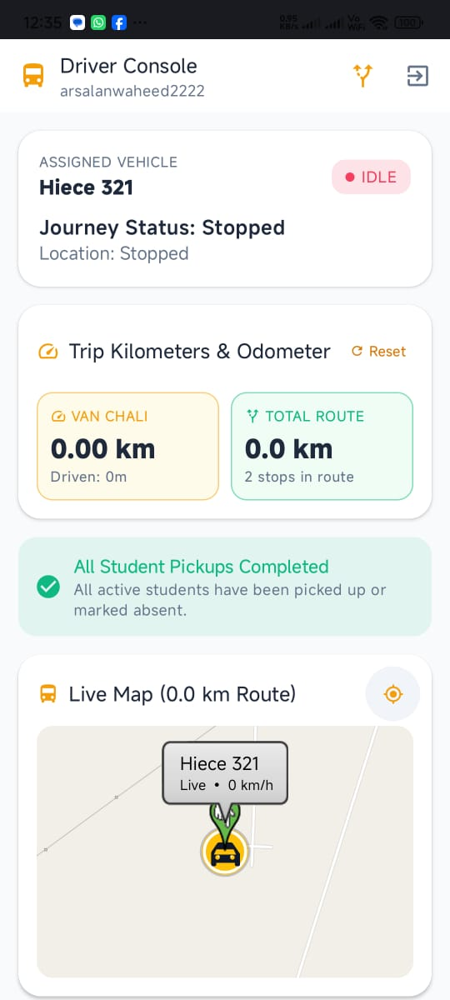
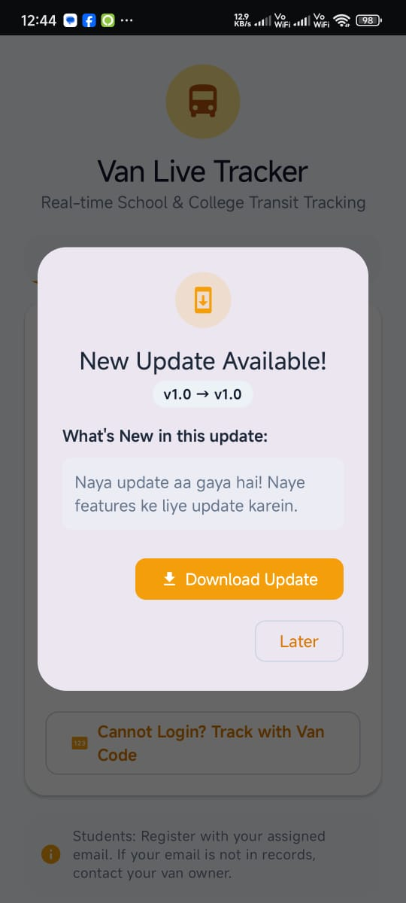
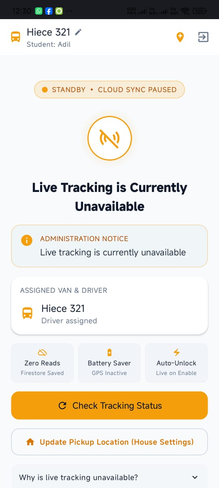

# 🚌 Van Tracker - Android Live Tracking & Fleet Management System

[](https://android.com)
[](https://kotlinlang.org)
[](https://developer.android.com/jetpack/compose)
[](https://m3.material.io/)
[](https://firebase.google.com)
[](LICENSE)

A modern, battery-efficient real-time school and college van tracking Android application built using **Jetpack Compose**, **Kotlin Coroutines**, **Firebase Realtime Database**, and **Cloud Firestore**.

Designed for three user roles: **Students / Parents**, **Drivers**, and **Administrators**, with centralized quota control and in-app automated updates.

---

## 📱 App Screenshots

| 🗺️ Live Student Tracking | 🎛️ Driver Console |
| :---: | :---: |
|  |  |
| **Real-time Map, ETA & Driver Details** | **Speedometer, Route Status & Trip Control** |

<br />

| ⏸️ Off-Duty / Quota Saver | 🚀 In-App Auto Updates |
| :---: | :---: |
|  |  |
| **Central Admin Tracking Control** | **Seamless APK Download from GitHub** |

---

## ✨ Key Features

### 📍 1. Real-Time Van Tracking (Students & Guests)
* **Live GPS Coordinates:** Sub-second latency updates via Firebase Realtime Database.
* **Smart Route & ETA:** Live van movement along predefined routes with calculated Estimated Time of Arrival (ETA).
* **Driver Information:** View driver name, vehicle registration number, and emergency contact button.
* **Speed Monitoring:** Real-time speed alerts for student safety.

### 🎛️ 2. Driver Console & Background Service
* **Digital Speedometer:** Visual speedometer showing current vehicle velocity.
* **Foreground Service:** Persistent location tracking with Android foreground notifications so tracking never disconnects when the phone is locked.
* **Trip Management:** Simple "Start Trip" and "End Trip" buttons.
* **Delay Broadcasts:** One-tap alert triggers for route delays or heavy traffic.

### 🛡️ 3. Centralized Quota & Off-Duty Control (Cloud Firestore)
* **Master Switch (`Settings/app`):** Controlled by the Super Admin to turn tracking on/off globally.
* **Database Read/Write Minimizer:** When `mobileDevice: false`, students and guests see a polite "Off-duty hours" screen with the schedule, eliminating unnecessary database listener reads and battery drain during non-school hours.
* **Driver Protection:** Drivers cannot bypass admin tracking policies.

### 🚀 4. Automated In-App Updates (GitHub Releases + Firebase)
* **Real-time Version Check:** Compares the installed version with `app_update` node in Realtime Database.
* **One-Click Download:** Downloads latest APK hosted on GitHub Releases directly onto the user's device.
* **Force Update Option:** Configurable urgent update requirement for critical app improvements.

---

## 🛠️ Architecture & Tech Stack

* **Language:** Kotlin 100%
* **UI Toolkit:** Jetpack Compose (Material Design 3, dynamic theming, edge-to-edge support)
* **Architecture:** MVVM (Model-View-ViewModel) with StateFlow and Coroutines
* **Database & Cloud:**
  * **Firebase Realtime Database:** High-speed real-time GPS coordinates stream (`vans/{vanId}`) & App Update config (`app_update`).
  * **Firebase Cloud Firestore:** System settings (`Settings/app`), authentication profiles, and scheduled routes.
* **Location & Maps:** Android FusedLocationProviderClient + High-precision Background Location Service.
* **Network & Image Loading:** Coil 3 for async avatar and icon rendering.

---

## 📂 Project Structure

```text
├── app/
│   ├── src/main/
│   │   ├── java/com/example/
│   │   │   ├── data/             # FirebaseManager, LocationService, Repositories
│   │   │   ├── model/            # Van, AppSettings, Driver, AppUpdateInfo models
│   │   │   ├── ui/
│   │   │   │   ├── components/   # AppUpdateDialog, Speedometer, StatusCards
│   │   │   │   ├── screens/      # StudentHomeScreen, DriverHomeScreen, LoginScreen
│   │   │   │   └── theme/        # Material 3 Color Schemes & Typography
│   │   │   └── MainActivity.kt   # Edge-to-edge root activity & navigation
│   │   └── res/                  # Drawables, layouts, and strings.xml
├── screenshots/                  # High-resolution README preview screenshots
├── database.rules.json           # Firebase Realtime Database Security Rules
├── firestore.rules               # Cloud Firestore Zero-Trust Security Rules
└── README.md
```

---

## ⚙️ Firebase Database Schemas

### 1. Central Admin Control (`Settings/app` in Firestore)
```json
{
  "mobileDevice": true,
  "message": "School off-duty hours. Tracking will resume at 1:30 PM.",
  "updatedAt": "2026-10-12T06:00:00Z",
  "updatedBy": "super_admin"
}
```

### 2. In-App Updates Config (`app_update` in Realtime Database)
```json
{
  "app_update": {
    "latestVersionCode": 2,
    "latestVersionName": "1.1",
    "releaseNotes": "• Mobile tracking optimization\n• Enhanced real-time map accuracy\n• Background battery saving",
    "downloadUrl": "https://github.com/<YOUR_USERNAME>/<YOUR_REPO>/releases/download/v1.1/app-debug.apk",
    "forceUpdate": false
  }
}
```

---

## 🚀 Getting Started

### Prerequisites
* Android Studio Ladybug or newer
* JDK 17 or higher
* Android SDK 35 (Android 15) minimum SDK 26 (Android 8.0)
* A Firebase Project with Realtime Database and Cloud Firestore enabled

### Installation & Run

1. **Clone the repository:**
   ```bash
   git clone https://github.com/<YOUR_USERNAME>/van-tracker.git
   cd van-tracker
   ```

2. **Connect Firebase:**
   * Place your `google-services.json` file inside the `app/` directory.
   * Deploy the provided security rules:
     ```bash
     firebase deploy --only firestore:rules,database
     ```

3. **Build and Run:**
   * Open the project in Android Studio.
   * Sync Gradle dependencies.
   * Run on a connected physical device or emulator.

---

## 📦 How to Release an Update to Users

1. Generate a new APK from **Build > Build Bundle(s) / APK(s) > Build APK(s)** in Android Studio.
2. Go to your GitHub repository -> **Releases > Draft a new release**.
3. Create a tag (e.g. `v1.2`) and upload your new `.apk` file under **Attach binaries**.
4. Right-click the uploaded APK link and select **Copy link address**.
5. In Firebase Realtime Database, update the `app_update` node:
   * Set `latestVersionCode` to your new version number (e.g. `3`).
   * Set `downloadUrl` to the GitHub Release link you just copied.
6. All active users will instantly see the update dialog!

---

## 📄 License

This project is licensed under the MIT License - see the [LICENSE](LICENSE) file for details.
